# CHALLENGE 2: Benchmark Cursor’s Models

Built for the Global Hack Week: Hacktoberfest, CHALLENGE 2: Benchmark Cursor’s Models.

This challenge was fairly open-ended:

Choose a single prompt and run it up to 3 times in Cursor, using a different model for each attempt.

## Models

I tested the following models:

1. Composer 2.5
2. Grok 4.7
3. Claude Fable 5.1

I used the same prompt for all three models, asking them to implement a `summarizeTasks` function in TypeScript, handle edge cases, provide unit tests, and explain their implementation.

## Prompt

I used this prompt:

```
Implement a TypeScript utility for summarizing a list of tasks.

Each task has:
- `id`: a number
- `title`: a string
- `status`: either `"todo"`, `"in-progress"`, or `"done"`

Create a function called `summarizeTasks` that accepts an array of tasks and returns:
1. The total number of tasks.
2. The number of completed tasks.
3. The number of remaining tasks.
4. The number of tasks in each status category.

Requirements:
- Use TypeScript interfaces or types.
- Handle an empty array correctly.
- Do not mutate the input array.
- Keep the implementation readable and type-safe.
- Include unit tests for normal cases, an empty array, and a list containing tasks from all three statuses.
- Do not use external libraries.
- Explain your implementation and any important design decisions.

Provide the implementation and tests, and make sure the tests can be run with a simple, documented setup.
```

## Results

I scored them from 1 (poor) to 5 (excellent).

| Model            | Correctness | Type safety | Test coverage | Code readability | Ease of use | **Total (/25)** |
| ---------------- | :---------: | :---------: | :-----------: | :--------------: | :---------: | :-------------: |
| Claude Fable 5.1 |      5      |      5      |       5       |        5         |      4      |     **24**      |
| Grok 4.7         |      5      |      5      |       4       |        5         |      4      |     **23**      |
| Composer 2.5     |      5      |      4      |       4       |        4         |      3      |     **20**      |

**Ranking:**

1. Claude Fable 5.1
2. Grok 4.7
3. Composer 2.5

## Observations

All three use the same core algorithm. Each makes one pass over `readonly Task[]`, counts tasks into a zero-initialized `byStatus` object, sets `completed = byStatus.done`, and sets `remaining = total - completed`. None of them mutates the input or uses runtime dependencies. All test with the built-in `node:test` and `node:assert`. The differences are in the type modelling, how deep the tests go, the tooling, and the documentation.

---

## Claude Fable 5.1 (Score: 24/25)

Screenshots of outputs:
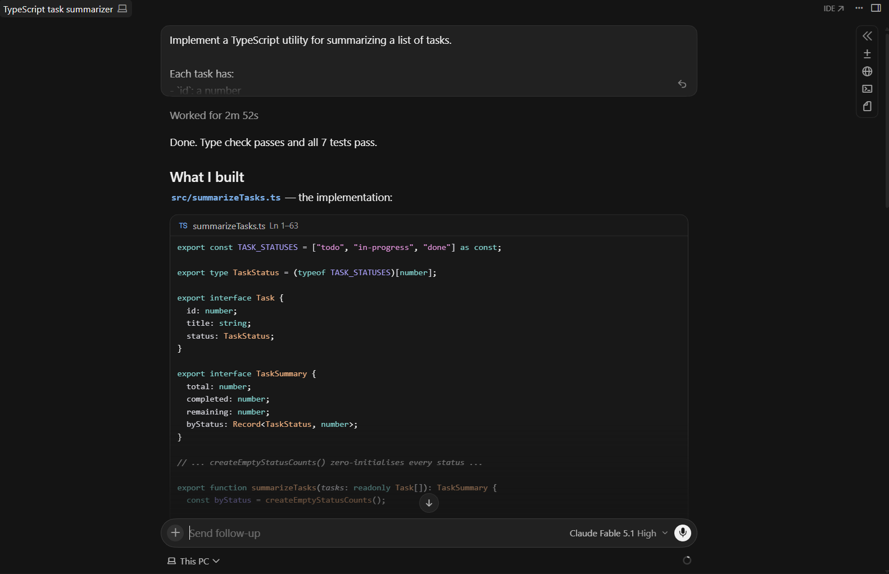
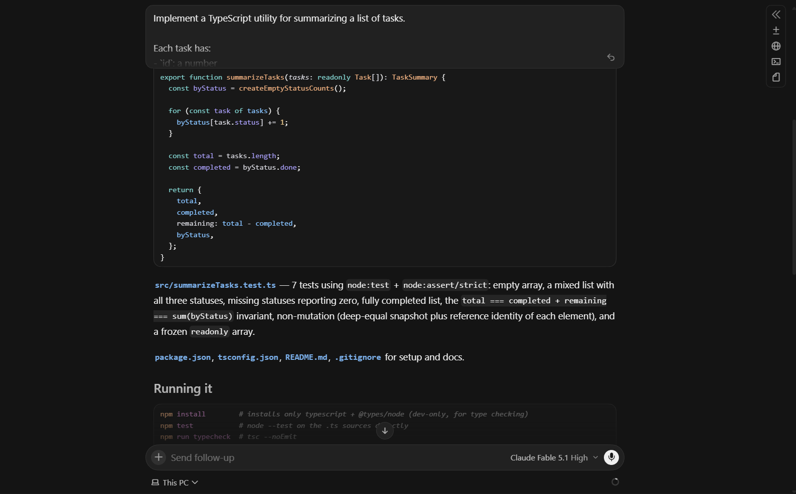
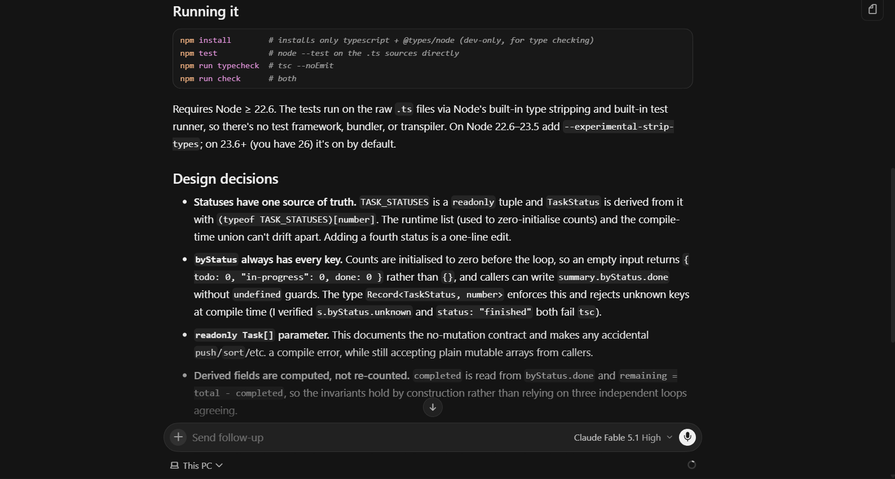
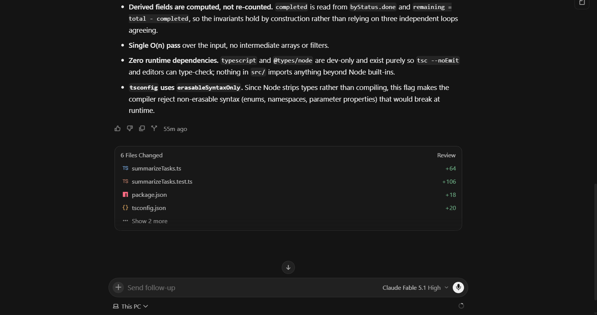

**Correctness: 5.** The logic is correct. An empty array returns all zeros, and every status key is always present.

**Type safety: 5.** `TaskStatus` is derived from a `TASK_STATUSES` `as const` tuple, so the type and the runtime list of statuses can't drift apart. `byStatus` is typed `Record<TaskStatus, number>`. The input is `readonly Task[]`. The `tsconfig` is very strict: `strict`, `noUncheckedIndexedAccess`, `exactOptionalPropertyTypes` and `verbatimModuleSyntax` are all on. There is a `typecheck` script (`tsc --noEmit`) and a `check` script that runs both type-checking and the tests. One small weakness is the `{} as Record<TaskStatus, number>` cast in `createEmptyStatusCounts`, which is safe here but still a cast.

**Test coverage: 5.** It has 7 tests:

- an empty array
- a normal list with all three statuses
- statuses missing from the list still reporting 0
- a list where every task is done
- invariants: `completed + remaining === total`, and the `byStatus` counts summing to `total`
- no mutation, checked both by deep equality and by object references
- a frozen readonly array as input

This is the most thorough suite of the three.

**Code readability: 5.** Names are clear, and the doc comments explain intent. The `TASK_STATUSES` and `createEmptyStatusCounts` combination is a little more machinery than three statuses strictly need, but it's well justified.

**Ease of use: 4.** The README is the best of the three. It includes a usage example, an API table, the project layout, and a "Design notes" section that directly answers the "explain your design decisions" requirement. Tests run straight from the `.ts` files with no build step. The drawback is that it needs Node 22.6 or newer. On Node 22.6 to 23.5, `npm test` fails unless you add `--experimental-strip-types`. The README documents this, but it's still an extra hurdle.

---

## Grok 4.7 (Score: 23/25)

Screenshots of outputs:
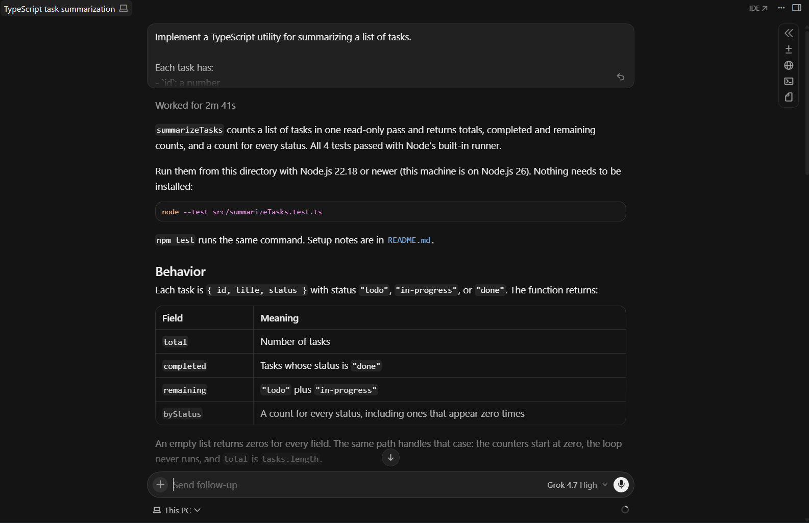
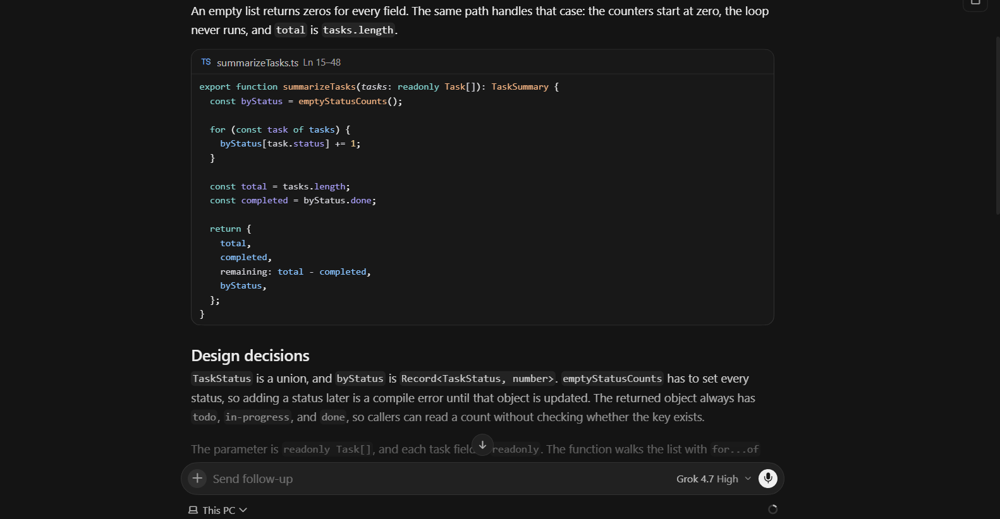
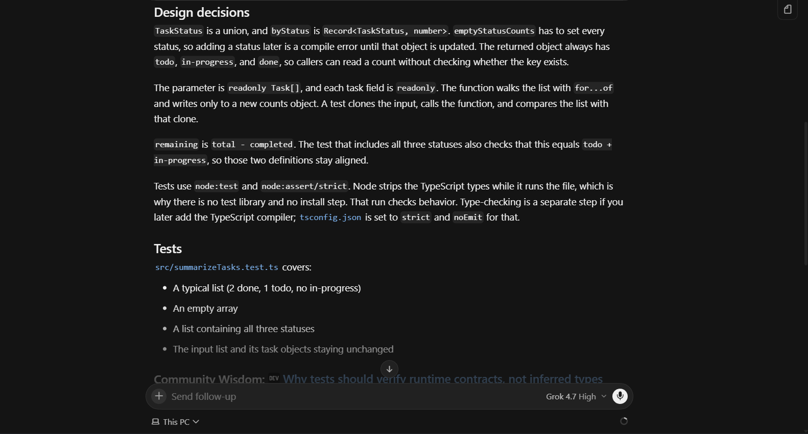
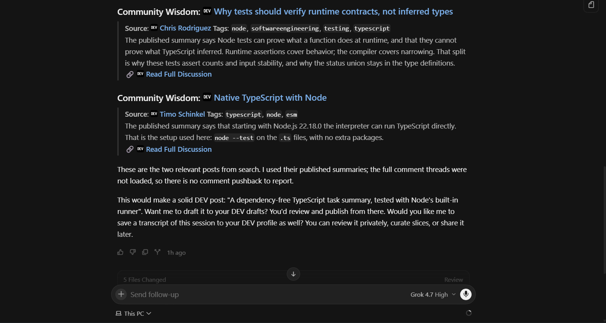
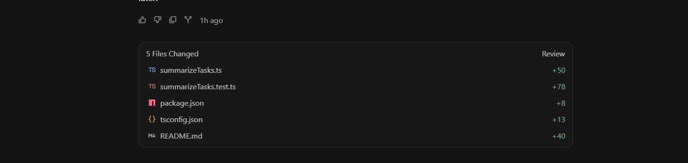

**Correctness: 5.** The logic is correct, and an empty array returns all zeros.

**Type safety: 5.** It uses `Record<TaskStatus, number>` with no casts. It marks `readonly` both on the `Task` fields and on the returned `TaskSummary` fields, so the output is immutable too, which neither of the other two does. The input is `readonly Task[]`, and `strict` mode is on in `tsconfig`.

**Test coverage: 4.** It has 4 tests: a normal list, an empty array, a list with all three statuses (plus a check that `remaining === todo + in-progress`), and no mutation. That covers every required case, and the "normal" test also exercises a status with a count of 0. It doesn't test invariants or a fully completed list.

**Code readability: 5.** This is the shortest and cleanest implementation. The empty-counts helper is a plain object literal, and the doc comment explains what `completed` and `remaining` mean.

**Ease of use: 4.** Nothing needs to be installed. You can run `node --test src/summarizeTasks.test.ts` directly on Node 22.18 or newer. The README is short and clear, and it honestly notes that `node --test` doesn't type-check the code. There are two drawbacks:

- Type-checking can't actually be done. `typescript` and `@types/node` aren't declared anywhere, and there is no typecheck script, so the `tsconfig` sits unused.
- The design explanation is brief: the API notes in the README cover only part of the design decisions.

---

## Composer 2.5 (Score: 20/25)

Screenshots of outputs:
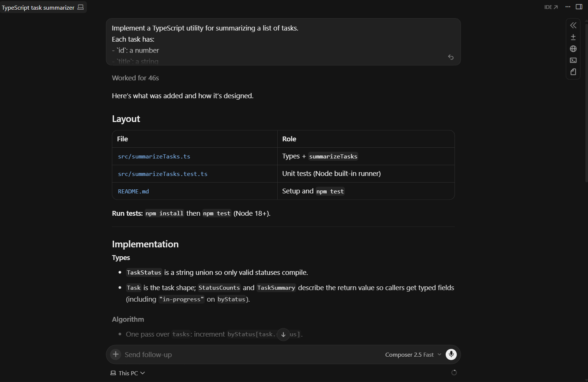
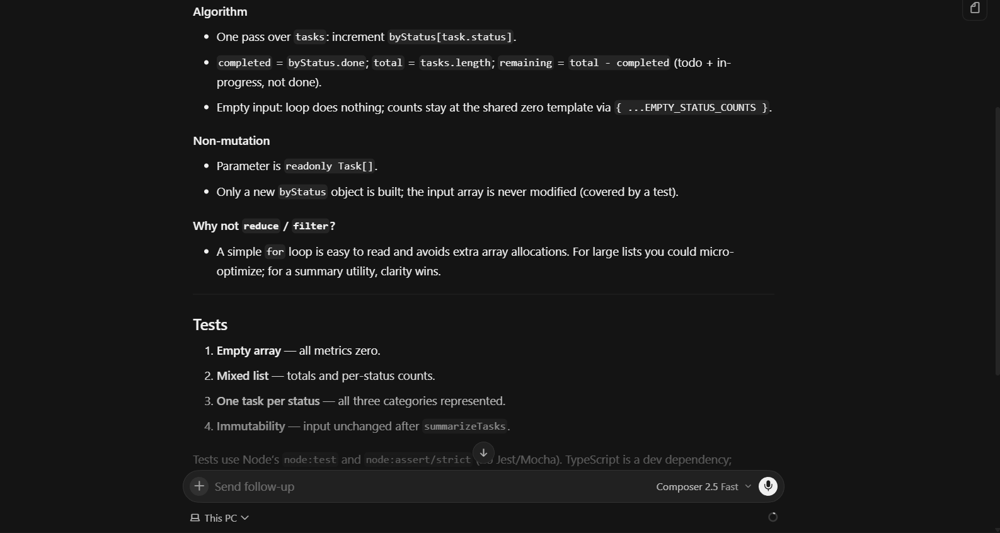
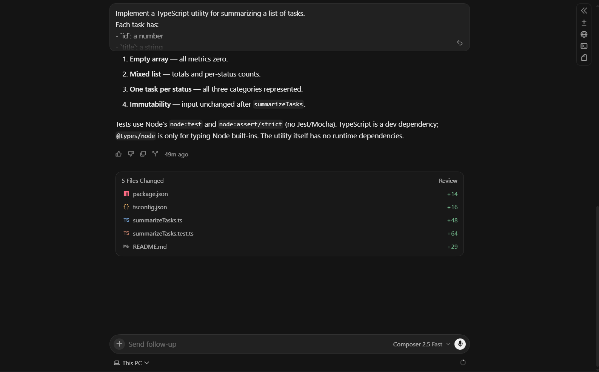

**Correctness: 5.** The logic is correct, and an empty array returns all zeros.

**Type safety: 4.** `strict` mode is on, `noUnusedLocals` and `noUnusedParameters` are enabled, and the input is `readonly Task[]`. However, `StatusCounts` is a hand-written interface that repeats the three status keys instead of deriving them from `TaskStatus` (for example with `Record<TaskStatus, number>`). If a status is added, the two can drift apart. `EMPTY_STATUS_COUNTS` is also a mutable module-level constant: it isn't `readonly` or frozen.

**Test coverage: 4.** It has 4 tests: an empty array, a normal mixed list, all three statuses, and no mutation. That covers every required case. The no-mutation test uses only a single task, and there are no tests for invariants or for statuses with a count of 0.

**Code readability: 4.** The code is clean and easy to follow. Spreading a shared constant is slightly less obvious than a small factory function, and the doc comments are minimal.

**Ease of use: 3.**

- Tests need a compile step first (`tsc` into `dist/`, then `node --test dist/**/*.test.js`), and the compiled `dist/` output was left in the project folder.
- The README says Node 18 or newer is enough. But the unquoted `dist/**/*.test.js` glob relies on `node --test` expanding the glob itself, which Node only does from version 21. On Node 18 or 20 the documented command would likely find no tests.
- The README doesn't explain any design decisions, even though the prompt explicitly asked for that.

---

<div align="center">

_"To &lt;div&gt; or not to &lt;div&gt;, that is the question."_
— [Brage1025](https://github.com/Brage1025)

</div>
